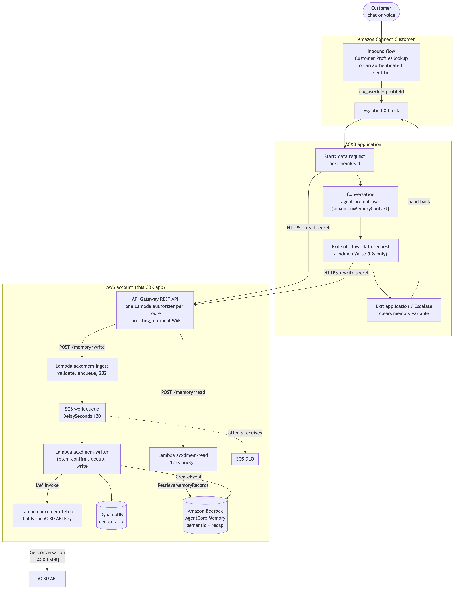

# Recall past conversations in Amazon Connect Customer with AgentCore Memory

This AWS CDK (Python) sample gives applications built with the Amazon Connect Customer
Agentic CX Designer (ACXD) a memory across conversations. When a returning customer starts
a new conversation, what they told the agent in earlier conversations is recalled from
Amazon Bedrock AgentCore Memory and handed to the agent prompt as a context variable.

The integration adds two data request nodes to your ACXD application: one at the start that
reads memory, and one in an exit sub-flow that asks the backend to write the finished
conversation. Nothing else in your conversation logic changes.

> **Important:** This is sample code for learning and experimentation, not a
> production-ready architecture. Review [Security](#security),
> [Data considerations](#data-considerations) and [Known limitations](#known-limitations)
> before any production use.

## Architecture



How a conversation flows through it:

1. **Identity.** The Connect Customer inbound flow looks up the customer in Customer
   Profiles with an identifier the flow trusts (caller number on voice, an authenticated
   identity on chat) and passes the `profileId` to the Agentic CX block as `nlx_userId`.
   In ACXD this becomes `{System.userId}`.
2. **Read.** The first node of the entry flow calls `POST /memory/read {profileId}`. The
   read Lambda retrieves up to three records each from the customer's `semantic` and
   `recap` namespaces in parallel (1.5 s budget) and returns `{memoryContext, hasMemory}`.
   A state modification stores `memoryContext` in the context variable
   `acxdmemMemoryContext`, which the agent prompt references. Any failure returns an empty
   string, and the conversation continues.
3. **Write.** Before every Exit application and Escalate node, the flow redirects to the
   `acxdmemExit` sub-flow, which calls `POST /memory/write {profileId, conversationId}`. The
   request carries IDs only. The ACXD `conversationId` is the Amazon Connect Customer
   contact id, so a memory event joins directly to the contact record. The ingest Lambda
   validates and enqueues it (`202`, tens of milliseconds).
4. **Fetch and write.** About 120 s later the writer Lambda asks the fetch Lambda to read
   the transcript with the ACXD SDK `GetConversation`, re-checks it 30 s later to make sure
   it is complete, checks that the conversation's `userId` matches the request, removes
   segments it already wrote, and calls AgentCore `CreateEvent`.
5. **Clear.** Every Exit application and Escalate node clears `acxdmemMemoryContext`, so the
   memory text is not handed back to the Connect flow.

The full design is in
[`docs/design.md`](docs/design.md).

## Prerequisites

- An AWS account and Region where Amazon Connect Customer, ACXD and
  Amazon Bedrock AgentCore Memory are available, with the AWS CDK bootstrapped
  (`cdk bootstrap aws://<account-id>/<region>`).
- An Amazon Connect Customer instance with:
  - a Customer Profiles domain;
  - an inbound flow that can resolve the customer to a profile with an **authenticated**
    identifier (see [Security](#security));
  - an ACXD workspace you can add an application, flows, data requests, a context variable
    and secrets to.
- Two ACXD programmatic users, each with an API key stored in AWS Secrets Manager:
  - one that can create resources (used by `assets/acxd` provisioning). An ACXD account
    administrator creates it in **Admin Hub > Programmatic Users**; the
    [deployment guide](docs/deployment-guide.md#account-prerequisites-once-per-account-and-region)
    shows how to store its key;
  - a workspace-scoped `read-only` user for the fetch Lambda.
    `assets/acxd/scripts/create-reader-key.mjs` creates it and stores its key.
- Account-level API Gateway CloudWatch Logs role set (the stack does not change this
  account-wide setting; `scripts/preflight.py` checks it, and the deployment guide has the
  commands to set it).
- Model access in Amazon Bedrock for the extraction model used by
  `scripts/provision_memory.sh` (default: the regional Claude Haiku 4.5 inference profile).
- Locally: Python 3.12 or later, Node.js 20 or later, AWS CDK CLI v2 (tested with
  2.1148.0), AWS CLI v2, `jq`.

## Quick start

```bash
python3 -m venv .venv && source .venv/bin/activate                          # 1. deps + offline checks
make install && make test
(cd assets/acxd && node scripts/create-reader-key.mjs --workspace-id <workspace-id> \
  --api-key-secret-id <admin-key-secret> --apply)                           # 2. read-only ACXD key
AWS_REGION_OVERRIDE=<region> AWS_PROFILE_OVERRIDE=<profile> ./scripts/provision_memory.sh   # 3. memory
# edit cdk.json context (memory ARN, workspace, application, API key secret), then:
python3 scripts/preflight.py --profile <profile>                             # 4. read-only checks
make deploy CDK_ARGS="--profile <profile>"                                  #    bundle + deploy
cd assets/acxd && npm run provision -- <options> --apply --deploy            # 5. ACXD assets
```

Step numbers match the [deployment guide](docs/deployment-guide.md), which walks through
every step and verifying the result; follow it for a first deployment. Step 5 also copies
the two endpoint secrets into ACXD Secrets, so run it again after the API stack is ever
replaced. Then set the real `acxdApplicationId` in `cdk.json` and `make deploy` again (if
you used the sample application), and apply the Connect flow snippet.

## Configuration reference

Set these in the `context` block of `cdk.json`, or pass `-c key=value` to `cdk` and
`preflight.py`. A missing key or an un-replaced `REPLACE_WITH_` value fails `cdk synth`
before anything is deployed.

| Key | Required | Default | Description |
|---|---|---|---|
| `memoryResourceArn` | Yes | | ARN printed by `scripts/provision_memory.sh` |
| `acxdWorkspaceId` | Yes | | ACXD workspace id (UUID) |
| `acxdApplicationId` | Yes | | ACXD application id (UUID). The writer skips conversations of any other application |
| `acxdApiKeySecretArn` | Yes | | Full Secrets Manager ARN (ending in `-XXXXXX`) of the read-only ACXD API key. Plain string, or JSON `{"apiKey": "..."}` |
| `accountId`, `region` | No | CDK defaults | Target environment |
| `resourcePrefix` | No | `acxdmem` | Prefix for every resource name; must start with `acxdmem` |
| `enableWaf` | No | `false` | Adds an AWS WAF web ACL with a rate-based rule to the API stage |
| `enableStripping` | No | `false` | Writer removes memory the agent restated before writing (see [Known limitations](#known-limitations)) |
| `writerMaxConcurrency` | No | `2` | Writer event-source `maxConcurrency`, 2-5. Caps calls to the ACXD API |

## Data considerations

This sample stores parts of customer conversations. Know what goes where before you deploy.

**What is stored**

| Where | What | Retention |
|---|---|---|
| AgentCore Memory, short-term events | The customer and agent turns of each written conversation (`actorId` = `profileId`, `sessionId` = ACXD `conversationId`) | 90 days (`MEMORY_EVENT_EXPIRY_DAYS`) |
| AgentCore Memory, long-term records | Facts the customer stated (`connect/profile/{profileId}/semantic`) and conversation recaps (`.../recap`) | Until deleted |
| DynamoDB `acxdmem-dedup` | Conversation and segment ids, watermark, status. No text | 90-day TTL; table is retained on `cdk destroy` |
| SQS work queue and DLQ | `profileId`, `conversationId`, phase, watermark, count. No text | Consumed within minutes; kept up to 4 days (queue) if the writer stops, 14 days (DLQ) |
| CloudWatch Logs | Ids, status, latency, the caller's (ACXD's) IP in API access logs; `profileId` only as a 12-character hash, never inside a namespace string. No text | 1 month |
| ACXD | The conversation record and runtime logs, as without this sample. The memory text appears there whenever the agent repeats it | ACXD retention |

**Deleting one customer's memory.** Use the AgentCore data plane APIs on the memory
resource: `ListMemoryRecords` + `BatchDeleteMemoryRecords` for the customer's two
namespaces, and `ListSessions` / `ListEvents` + `DeleteEvent` for the actor's events.

**Encryption.** Data in transit uses TLS (1.2 minimum on the API). AgentCore Memory encrypts data at rest by
default; for a customer managed KMS key, pass `encryptionKeyArn` to `CreateMemory` (not set
by `provision_memory.sh`). [`docs/design.md` §6.2](docs/design.md#62-encryption-at-rest-no-customer-managed-kms-key)
explains why the sample does not add a customer managed KMS key.

## Cost

Use the [AWS Pricing Calculator](https://calculator.aws/) with your own volumes. Per
written conversation the sample adds:

- **AgentCore Memory** (the dominant cost): one `CreateEvent`, long-term extraction by the
  memory strategies (model tokens), and two `RetrieveMemoryRecords` calls per read. See
  [Amazon Bedrock AgentCore pricing](https://aws.amazon.com/bedrock/agentcore/pricing/).
- **ACXD and Amazon Connect Customer** usage is billed as without the sample. Check
  whether data requests affect your ACXD pricing.

## Security

The read and write routes are public HTTPS endpoints, because ACXD calls them from the
internet. They are protected as follows:

- **One Lambda REQUEST authorizer per route**, each comparing the `x-acxdmem-secret` header
  in constant time with its own Secrets Manager secret (current and previous value accepted
  during rotation). The Allow policy is scoped to that route's `methodArn`. A read secret
  cannot call the write route, and the reverse. The request validator also requires the
  header and a closed request model (`additionalProperties: false`, per-field
  `maxLength`).
- **No Lambda Function URLs and no wildcard principals.** Every Lambda permission names
  `apigateway.amazonaws.com` with a `SourceArn` on its exact route or authorizer. CDK
  assertions in `tests/test_stacks.py` fail the build otherwise.
- **TLS 1.2 minimum.** The stack sets the enhanced security policy
  `SecurityPolicy_TLS13_1_2_PFS_PQ_2025_09` (TLS 1.3, or TLS 1.2 with forward-secret
  AES-GCM suites) with `STRICT` endpoint access mode.
- **Throttling** on the stage (50 requests/s, burst 100), JSON access logs (ids, status,
  latency, caller IP, TLS version; no headers or body), execution logging at `ERROR`, data
  trace off, JSON Lambda logs with the request id on every line. Optional AWS WAF.
- **Write requests cannot inject text.** The write route carries IDs only. The writer reads
  the transcript from ACXD itself and rejects the write if the conversation's `userId` does
  not match the requested `profileId`.
- **Least privilege.** The read Lambda can only call `RetrieveMemoryRecords` on the memory
  ARN; the writer only `CreateEvent` (plus `RetrieveMemoryRecords` with `enableStripping`),
  conditional writes on its table and `InvokeFunction` on the fetch Lambda; only the fetch
  Lambda can read the ACXD API key, which belongs to a `read-only` programmatic user. No
  IAM `Resource: *`.
- **CDK Nag** `AwsSolutionsChecks` runs on every synth with no unsuppressed findings.

**Your responsibility: authenticate the identity.** The `userId` check cannot detect a
Connect flow that resolves the profile from a value the customer controls. If your chat
flow looked up the profile by an email address the customer typed or passed as an
unauthenticated contact attribute, anyone could read and write another customer's memory.
Key the lookup on an identifier the flow authenticated: the caller number on voice, or an
identity from your authenticated chat (server-side `StartChatContact`, or a JWT-secured
communications widget). Unauthenticated chat must take the no-memory path. Never copy
`$.AgenticCX.ContextVariables.acxdmemMemoryContext` into contact attributes.

Threat model:
[`docs/design.md` §6](docs/design.md#6-endpoint-authentication-and-threat-model). Security
posture against AWS guidance, with every deviation and its reason:
[`docs/security-posture.md`](docs/security-posture.md).

## Teardown

In this order (details in the [deployment guide](docs/deployment-guide.md#teardown)):

1. Remove the Agentic CX block changes from your Connect flow (or delete the flow you
   created), and remove the memory nodes from your own ACXD flows.
2. `cd assets/acxd && npm run teardown -- <options> --apply` deletes the `acxdmem*` ACXD
   resources. `node scripts/create-reader-key.mjs ... --delete --apply` deletes the
   read-only user, its key and its secret.
3. `make destroy` (with the same context as the deploy, via `CDK_ARGS`).
4. Delete what `cdk destroy` keeps on purpose: the `<prefix>-dedup` table (default
   `acxdmem-dedup`), then (this deletes all stored customer memory) the memory resource and
   its execution role.

## Known limitations

- **Conversations that end without an Exit node are not captured.** Idle timeouts, errors
  and abandoned conversations do not run the exit sub-flow, so they write no memory. Only conversations that reach an Exit application or
  Escalate node are written. Earlier
  memory is unaffected and is still read next time. A second Agentic CX block in the same
  contact (re-entry) can also hand back without the write.
- **Restated memory.** When the agent repeats stored facts, they become part of the next
  transcript. The extraction override and the prompt rule limit re-extraction. `enableStripping` is an optional backstop whose 8-word
  matching threshold has not been tuned on real conversations.
- **Voice**: speech recognition errors become part of the transcript; extraction keeps
  clear facts and records the rest as unclear in the recap.

## Testing

```bash
make test        # everything offline, no AWS credentials needed
make ci          # clean install, make test, placeholder synth
```

## Repository layout

```
app.py, cdk.json            CDK app and context validation
stacks/                     acxdmem-writer (queue, writer, fetch, dedup, alarms), acxdmem-api (API, authorizers, read, ingest)
src/acxd_memory/            shared Python: identity, reader, writer, dedup, transcript, stripping, state machine
lambdas/                    Lambda handlers (Python; fetch step in Node.js)
assets/acxd/                ACXD assets as code, provisioning and teardown, Connect flow snippet
scripts/                    provision_memory.sh, preflight.py, bundle_lambdas.sh
tests/                      pytest unit tests and CDK assertions
docs/                       design, deployment guide, security posture
```

## License

This library is licensed under the MIT-0 License. See the [LICENSE](LICENSE) file.
